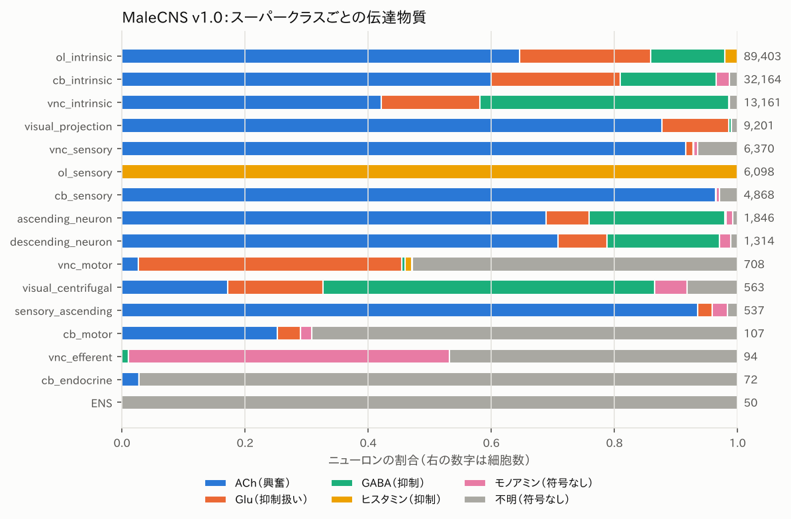
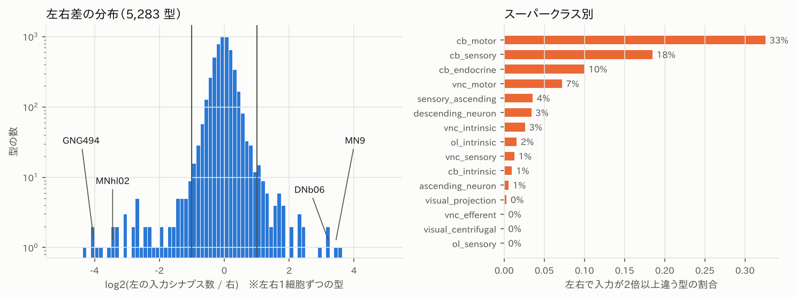
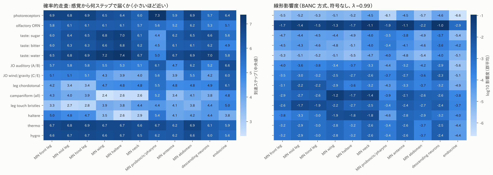
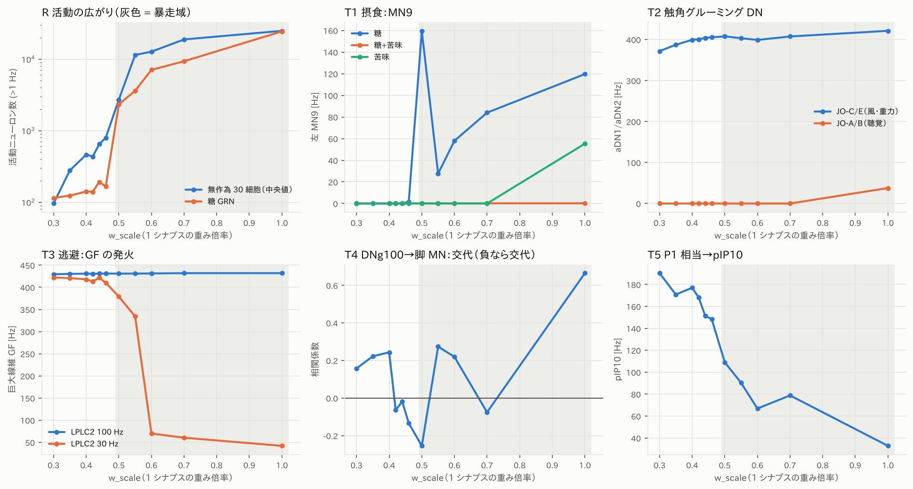
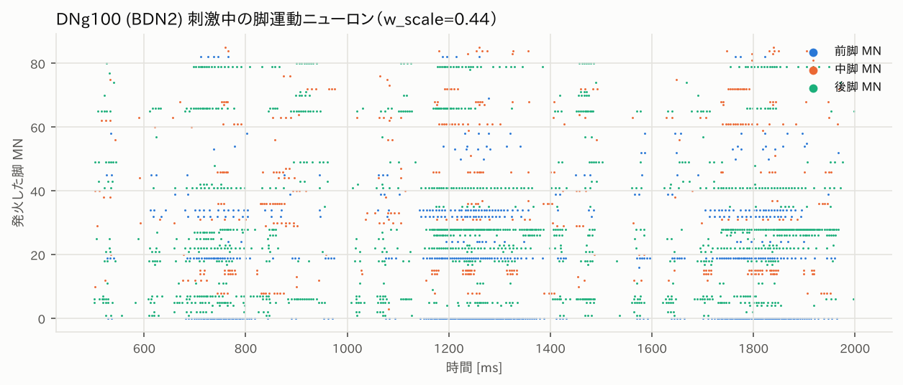
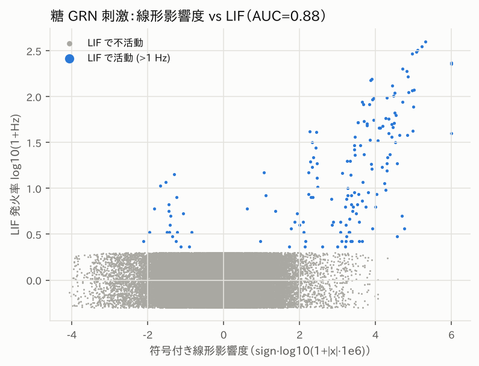

# 調査報告 #02：MaleCNS を動かして中身を確かめる

調査日: 2026-10-17 ／ 対象: MaleCNS v1.0 の構造解析と全中枢 LIF シミュレーション、公開後に出てきた扱い方・道具

> 出典の区別は #01 と同じで、[実測] はこのリポジトリのコードで計算した値。
> 再現手順は `README.md` を参照（`experiments/01_structure.py` → `02_lif.py` → `03_figures.py`）。

---

## 0. 要約

- **MaleCNS 全中枢（166,700 ニューロン、2,460 万の符号付き結合）を LIF で動かすコードを書いた。** CPU 1 コアで 1 秒分のシミュレーションに数秒かかる。構造解析の道具（欠損の検出、確率的走査、線形影響度、入力源の内訳）も添えた。
- **データの扱いで結論が変わる点が多い。**
  - (1) 脳どうしで比べると、MaleCNS は FlyWire より 1 ニューロンあたりのシナプスが 1.2〜1.7 倍多い。Shiu 2024 の重みをそのまま移すと全体が暴走する。
  - (2) 周辺部（MN・感覚ニューロン）に再構成の欠けが集中している。脳内 MN の 33% の型で左右が 2 倍以上違い、MN9 の右は左の 1/11 しかない。
  - (3) 味覚ニューロンの種類分けは、MaleCNS と同時に出た味覚コネクトーム論文（Tastekin 2026）で更新された。
- **重み倍率に鋭い相転移がある。** 0.46 倍以下では刺激が局所にとどまり、0.50 倍以上では VNC の運動系全体へ溢れる。結果はこの 1 点の選び方に強く依存するので、倍率に対する曲線で報告した。
- **局在域で通ったもの**
  - 触角の風・重力受容（JO-C/E）→ 触角グルーミング DN：DN 全体の中で上位、聴覚側では動かない。
  - P1 相当 → 求愛歌の指令 DN（pIP10）。
  - 巨大線維 → TTMn の速い 1:1 伝達には電気シナプスが必要。
  - 摂食：糖 → MN9 が閾値的に点火し（0.40 倍では 150 Hz 付近）、苦味の同時刺激で用量依存的に抑えられる。
- **通らなかったもの**
  - 巨大線維が弱い刺激でも 400 Hz 超に張り付く（順応が無い）。
  - DNg100 で脚の屈筋・伸筋の交代リズムが出ない。
  - 水の GRN → MN9。
- **線形影響度は LIF の活動をかなりよく予測する**（AUC {{AUC_SHORT}}）。ただし MaleCNS の結合行列の先頭モードは触角葉の局所ニューロン塊に局在しているので、BANC と同じ λ=0.99 では感覚群ごとの差が潰れる。
- **HH に上げるのはまだ早い。** 失敗の原因は、細胞ごとの興奮性・順応・電気シナプス・段階電位の欠如で、スパイク生成の機構ではない。
  - 順応を足す（AdEx 化）、型ごとのパラメータを学習する、と段階を踏む。
  - 多区画 HH は APL・GF・MN・LPTC・DN といった「点ニューロンでは表せない」細胞に限って入れる（§6）。

---

## 1. MaleCNS 公開後に出てきたもの（2025-10 〜 2026-10）

### 1.1 同時・後続の論文とデータ

| 名前 | 何か | 本プロジェクトへの意味 |
|---|---|---|
| **Tastekin et al., *Cell* 2026**「The complete gustatory connectome of adult *Drosophila*」 | MaleCNS と同じ号の姉妹論文。唇弁 GRN を出力結合で LB1–4 に分類し、GAL4 系統と照合して味の種類を割り当てた（LB1a–d = 苦味、LB3a = 水、LB3b = 低塩、LB3b–c = 糖、LB3d = 重金属・高塩） | **味覚入力の正解表**。FlyWire の注釈 v3.2.0 も追随した。Shiu 2024 で使われた旧「sugar/water」クラスには水・高塩の細胞が混ざっていたと明記されている |
| Berg et al., *Cell* 2026（MaleCNS 本体） | v0.9（2025-10）→ v1.0（2026-06）→ 論文（2026-09） | 型名は FlyWire / hemibrain / MANC と対応済み。FlyWire 側の型は 4.6% だけ改訂された |
| VNC の発生アトラス（*Nature* 2026） | VNC の発生トランスクリプトーム・アトラスを成虫コネクトームに対応づけた | 型ごとの遺伝子発現（受容体・チャネル）に向けた足掛かり。まだ全脳のイオンチャネル表は無い |
| 「DN の軸索-軸索シナプス」（PMC13126034） | 下行ニューロンに軸索間シナプスが多い | 単一コンパートメントのモデルでは表せない入力がある |
| Okuno et al.（eLife reviewed preprint 107990） | 全脳カルシウムイメージングの機能的結合と、FlyEM・FlyWire の構造的結合を比較 | ROI を細かくするほど構造と機能の相関が下がる。前後シナプスが分離していないニューロンほど機能的結合への寄与が大きい |

### 1.2 MaleCNS を扱う道具

| 道具 | 内容 | 状態 |
|---|---|---|
| **FLYCNS**（GitHub: IONOFIELD/FLYCNS, BSD-3） | Shiu 2024 の LIF を MaleCNS v1.0 に移植したもの。重みを **0.4 倍**し、**5 シナプス未満の結合を捨て**、モノアミンと不明は符号 0。GF→TTMn/PSI と JO-B→GF のギャップ結合を文献から追加。GF と脳内 MN に順応を入れて較正している。文献の生理と照合する 53 項目のテストを持つ | 全体 29/53 合格。ただし**独立検証は 5/19**。糖 → MN9（100 Hz）は失敗。逃避は「較正した回路で、予測ではない」と自ら明記 |
| **ConnectomeInfluenceCalculator**（Drugowitsch lab, BSD-3） | BANC 論文の影響度スコア。`τ dr/dt = −r + W̃r + s`、`W̃ = 0.99·W / λmax` の定常解。`adjusted = log(r) + 24`（BANC での定数） | MaleCNS 用ローダは無い。表を自分で渡せば動く。R 版は natverse/influencer |
| **Connectome Interpreter**（Yin, Jefferis, Cardona ほか；bioRxiv 2025.09.29.679410） | 入力割合で正規化した行列の冪で多段の有効結合を計算する。興奮・抑制の経路を分けて合成し、偶数回の抑制は脱抑制として興奮側に数える。微分可能なレートモデルもある | MaleCNS 対応はドキュメント上は未記載 |
| Kopel, arXiv 2609.33054（事前登録型のスペクトル解析） | MaleCNS のランダムウォーク行列の固有値と混合時間 | **閾値 1 と 5 で結論が変わる**（\|λ2\| 0.945 対 0.9965）。入力の少ない細胞（視細胞など）が正規化行列の先頭モードを作る。符号の付け方にはほぼ鈍感 |
| Cho, Kang, Kim, arXiv 2610.10014 | MaleCNS の配線だけをマスクにして、エッジごとの重みを学習した tanh RNN | 符号も遅延も使わない。それでも、配線を保ったまま繋ぎ替えた対照より課題成績が高い |
| natverse `malecns`（R）、Codex `?dataset=mc`、NeuronBridge（2025-11 対応） | 取得・閲覧・GAL4 系統との対応 | |

### 1.3 道具ごとに約束がばらばら（混ぜると壊れる）

| 項目 | このリポジトリ | FLYCNS | Influence Calculator | Connectome Interpreter | Kopel |
|---|---|---|---|---|---|
| 行列の向き | `W[post, pre]` | — | 行 = post | **行 = pre** | **行 = pre** |
| Glu | −1 | −1 | −1 | 予測 NT による | −1 |
| ヒスタミン | −1 | −1 | （例では未指定） | — | −1 |
| DA / OA / 5-HT | 0（`fast_only`） | 0 | 例では OA・5-HT が −1 | — | 0（別案で DA +1, OA・5-HT −1） |
| 不明 | 0 | 除外 | 除外 | — | 0 |
| 閾値 | 1（可変） | 5 | 5 | — | 1 と 5 |
| 重み | 数 × 0.275 mV × 倍率 × (346 / 受け手の総入力)^α | 数 × 0.275 × 0.4 | 数（または入力割合） | 入力割合 | 入力割合 |

---

## 2. 作ったもの

```
secon/data.py       MaleCNS v1.0 の取得・キャッシュ。伝達物質の決定（consensus → 型予測 → 個体予測）と符号プリセット
secon/structure.py  左右差による欠損検出、確率的走査（Schlegel 型）、線形影響度（BANC 型）、固有値、入力源の内訳
secon/lif.py        numba による全中枢 LIF（Shiu 2024 の式）。細胞の大きさ補正 α、スパイク頻度順応、ギャップ結合
secon/groups.py     感覚モダリティと効果器のグループ定義（Tastekin 2026 の味覚対応を含む）
experiments/01_structure.py   構造解析 → results/structure/
experiments/02_lif.py         回路テストを重み倍率ごとに → results/lif/
experiments/03_figures.py     図 → docs/figures/
tests/test_lif.py             伝播・遅延・抑制・サイレンシング・ギャップ結合の単体テスト
```

- 全中枢（166,700 ニューロン、2,460 万の符号付きエッジ）を CPU 1 コアで動かすと、1 秒分のシミュレーションに 3〜5 秒かかる（活動が広がると遅くなる）。
- 刺激は Poisson 入力。サイレンシングは「発火させない」で実装。

---

## 3. 構造から分かったこと [実測]

### 3.1 規模と重みの分布

- ニューロン 166,700、ニューロン間エッジ 2,558 万、シナプス 1.24 億。
- 1 エッジあたりのシナプス数は中央値 2、90 パーセンタイル 10、99 パーセンタイル 46。**5 シナプス以上のエッジは全体の 24% だが、シナプスの 72% を運ぶ。**
- 1 ニューロンあたりの入力シナプス数は、中央値 346、下位 5% が 48、上位 5% が 2,667、上位 0.1% が 18,516。最大は APL の 119,935。
  - 巨大線維 GF は 18,366、MBON01 は 24,345、DNg100 は 20,368。
  - **一律の「1 シナプス = 0.275 mV」は、この 3 桁の幅を無視している**（§6）。
- 脳内だけで比べると、1 ニューロンあたりのシナプス数は 674（閾値 5 なら 473）。FlyWire は 391 なので、**MaleCNS は 1.2〜1.7 倍多く検出している**。Shiu 2024 の重みを移植すると強すぎる理由の一つ。

### 3.2 伝達物質と興奮・抑制



- ACh 104,042、Glu 29,622、GABA 22,122、ヒスタミン 7,905、5-HT 404、DA 395、OA 140、不明 2,070。
- 出どころは、文献の正解 85,484、合議予測 78,039、個体予測 780、型予測 327、不明 2,070。
- Glu を抑制として数えると、**入力の 44%（中央値）が抑制性**。Glu の扱い一つで全体の E/I バランスが大きく動く。
- VNC の MN は Glu が 43%、不明が 53%。NMJ では Glu が興奮であることと整合する。中枢内への出力は少ないので、モデルへの影響は小さい。

### 3.3 再構成の欠け：左右差で見つける



- 左右に細胞がある 11,281 型を比べると、211 型（1.9%）で 1 細胞あたりの入力シナプス数が 2 倍以上違う。
- 欠けは**周辺部に集中**している：脳内 MN 33%、脳の感覚ニューロン 18%、内分泌 10%、VNC の MN 7%、DN 3%。中枢の介在ニューロンは 1〜3%。
- 例：
  - MN9 の右は 556 シナプスで、左 6,012 の 1/11。
  - MN11D、脚 MN の MNhl60・MNhl02、DNb06、DNge119、GNG494 など。
- §4 のテストで読み出しに使った細胞は、MN9 以外は左右差 1.5 倍以内だった：GF（DNp01）、TTMn、PSI、DNg100、pIP10、aDN1（DNg62）、aDN2（DNge078）。MN9 は欠けの少ない左だけを使った。
- **身体化のインターフェースになる MN と感覚ニューロンほど欠けが多い。** 読み書きの部位を選ぶ前に、必ずこの表（`results/structure/lr_asymmetry.csv`）を見る。

### 3.4 効果器はどこから入力を受けているか

| 効果器 | VNC 介在 | 脳介在 | DN（直接） | AN | 感覚（直接） |
|---|---|---|---|---|---|
| 脚 MN（前・中・後） | 84–88% | 0% | 6–9% | 3–6% | 2–3% |
| 翅 MN | 84% | 0% | 8% | 5% | 3% |
| 平均棍 MN | 60% | 0% | 17% | 12% | 11% |
| 首 MN | 12% | 19% | **37%** | 25% | 5% |
| 口吻・咽頭 MN | 0% | **78%** | 11% | 2% | 3% |
| 触角 MN | 0% | 47% | 31% | 17% | 2% |
| DN | 3% | 60% | 13% | 13% | 4%（＋視覚投射 6%） |

- 脚と翅の MN は、入力の 9 割近くを VNC の前運動介在ニューロンから受ける。DN からの直接入力は 1 割未満で、Cheong et al. 2024（MANC）の「DN→MN の直結は少ない」と一致する。
  - → **DN の活動だけで脚を動かすと、VNC の計算を丸ごと飛ばすことになる**（#01 の Eon 方式の限界）。
- 首は DN と AN の直結が 6 割で、脳からの直接制御に近い。

### 3.5 感覚から効果器までの距離



- **確率的走査**（左）：入力割合 30% で確率 1 になる規則で、各感覚群から何ステップで届くかを数えた。どの感覚群からも CNS の 99.8% に届く。
- **局所ループが最短**：
  - 脚の触覚剛毛 → 中・後脚 MN が 2.7〜2.8 ステップ。
  - 鐘状感覚子 → 翅 MN が 2.4、平均棍・首 MN が 2.6。
  - 平均棍 → 平均棍 MN が 2.6。
  - 味覚 → 口吻 MN が 4.4〜5.0。
  - BANC 論文の「効果器はまず同じ体部位の感覚に駆動される」と同じ構図がオスでも見える。
- **遠いのは**視細胞（5.7〜7.3）、嗅覚（5.1〜6.2）、温度・湿度（5.6〜6.9）。これらは脳の上位中枢を経由する。
- **線形影響度**（右）は λ=0.5、種 1 細胞あたりで示した。λ=0.99 の問題は 3.6 を参照。

### 3.6 結合行列の先頭モードは触角葉にある

- 符号なしの結合行列（閾値 5）の絶対値最大の固有値は 5,454。固有ベクトルの重みは、参加比 53 細胞ぶんに集中している。中身は触角葉の局所ニューロン（lLN2F_a/b、lLN2T、v2LN30、il3LN6、lLN1_bc）で、質量の 99% が脳の介在ニューロン。
- 符号付き（`fast_only`）では最大固有値が 3,749 で、参加比 44。**ほぼ全量がコリン作動性の興奮性局所ニューロン lLN1_bc（30 細胞）** に乗っている。この 30 細胞の間には 86,864 シナプスがあり、存在するエッジ 420 本の平均は 1 本あたり 207 シナプス。
- そのため、BANC 方式の影響度を λ=0.99（先頭モードの利得 100 倍）で計算すると、刺激する感覚群によらず効果器のプロファイルが似通ってしまう。
  - 13 感覚群の効果器プロファイルどうしの相関の平均は、λ=0.99 で {{CORR99}}、λ=0.5 で {{CORR05}}（符号なし）。
  - 温度と湿度の行は、λ=0.99 では小数第 1 位まで一致した。
- 一方、LIF ではこの塊はまったく発火しなかった（§4.2）。周囲の GABA 作動性局所ニューロンに抑え込まれていると考えられる。**線形の先頭モード ≠ 動的に効く経路**。
- 教訓：線形影響度を使うなら λ を下げるか、先頭モードを除く。そして LIF などの非線形モデルと突き合わせる。Kopel（§1.2）が指摘した「正規化行列の先頭モードは入力の少ない細胞が作る」とは別の、**カウント行列側の落とし穴**。

---

## 4. 全中枢 LIF を動かして分かったこと [実測]

### 4.1 設定

- 式は Shiu 2024 と同じ：`v0 = v_reset = −52 mV`、`v_th = −45 mV`、`τm = 20 ms`、`τsyn = 5 ms`、不応期 2.2 ms、遅延 1.8 ms。
- 重みはシナプス数 × 0.275 mV × **w_scale**。刺激は Poisson で、1 発ごとに g に 68.75 mV を加える。
- 符号は `fast_only`（ACh +、GABA/Glu/ヒスタミン −、その他 0）。閾値は 1 シナプス。
- 1 条件 3 試行 × 1 秒（歩行のみ 3 秒 × 1 試行）。
- 対照 R として、中枢の ACh ニューロンを無作為に 30 個選んで刺激し、活動がどこまで広がるかを測った。

| テスト | 刺激 | 合格の条件 | 根拠 |
|---|---|---|---|
| R 局在 | 無作為 30 細胞 100 Hz（3 組） | 活動細胞（>1 Hz）が 1,000 未満 | 同じ大きさの対照 |
| T1 摂食 | 糖 GRN（LB3b/c、34 個）100 Hz | 左 MN9 > 10 Hz、苦味単独で < 1 Hz、糖+苦味で半分未満 | Shiu 2024、Tastekin 2026 |
| T2 触角グルーミング | JO-C/E（335 個）100 Hz | aDN1/aDN2 > 10 Hz、全 DN 中 10 位以内、JO-A/B では半分未満 | Hampel 2015、Shiu 2024 |
| T3 逃避 | LPLC2（185 個）30/100 Hz | (a) ギャップ有で GF→TTMn 1:1・< 1.5 ms、(b) 化学のみでは満たさない、(c) LPLC2 30 Hz で GF < 100 Hz | Allen 2006、von Reyn 2017 |
| T4 歩行 | DNg100（BDN2）100 Hz | 脚 MN 集団に 4–20 Hz のピーク（中央値比 > 5）、屈筋と伸筋の相関 < −0.2 | Bidaye 2020、Pugliese 2025 |
| T5 求愛 | P1 相当（オス特異的 pC1、fru+dsx、78 個）100 Hz | pIP10 > 10 Hz | Ding 2019 ほか |

### 4.2 重み倍率で「局在」と「暴走」が切り替わる



- 無作為 30 細胞の刺激で活動する細胞数は、倍率 0.46 で 799、**0.50 で 2,717**、0.55 で 11,429、1.0（Shiu の値そのまま）で 24,877。境界は 0.46〜0.50 の間にある。
- 暴走のとき新たに動き出すのは、大半が **VNC の介在ニューロンと運動ニューロン**だった（0.46 → 0.50 で糖刺激時に新規 2,163 細胞、うち VNC 介在 847・MN 238）。飛翔パワー筋の DLMn は 221 Hz、脚の屈筋 MN も含まれる。
  - 脳の局所的な信号が、VNC の運動系全体へ溢れ出す形の相転移。
- 触角葉の興奮性局所ニューロン塊（§3.6）は、暴走中も沈黙していた。線形代数の先頭モードと、実際に暴走する経路は別物。
- **FLYCNS の 0.4 倍は局在域の端にあたる。** 移植の補正として、MaleCNS 側の検出シナプスが多いことからの見積もりと（§3.1。脳内で 1.2〜1.7 倍 → 0.58〜0.83 倍）、相転移の位置（0.46〜0.50）が近い。

### 4.3 回路テストの合否（α = 0、Shiu 型の重み）

灰色の暴走域は倍率 0.50 以上。✓ = 合格、× = 不合格。

| テスト | 0.3 | 0.35 | 0.4 | 0.42 | 0.44 | 0.46 | 0.5 | 0.55 | 0.6 | 0.7 | 1 |
|---|---|---|---|---|---|---|---|---|---|---|---|
| R 局在（無作為刺激の活動 < 1000） | ✓ | ✓ | ✓ | ✓ | ✓ | ✓ | × | × | × | × | × |
| T1 糖→MN9 / 苦味で抑制 | × | × | × | × | × | × | ✓ | ✓ | ✓ | ✓ | × |
| T2 JO-C/E→グルーミング DN（選択的） | × | ✓ | ✓ | ✓ | ✓ | ✓ | ✓ | ✓ | ✓ | ✓ | ✓ |
| T3a GF→TTMn 1:1・<1.5 ms（ギャップ有） | ✓ | ✓ | ✓ | ✓ | ✓ | ✓ | ✓ | ✓ | ✓ | × | × |
| T3b 化学シナプスだけでは速い 1:1 にならない | ✓ | ✓ | ✓ | ✓ | ✓ | ✓ | ✓ | ✓ | ✓ | ✓ | ✓ |
| T3c GF が飽和しない（LPLC2 30 Hz で < 100 Hz） | × | × | × | × | × | × | × | × | ✓ | ✓ | ✓ |
| T4 DNg100→脚 MN リズム（4–20 Hz・交代あり） | × | × | × | × | × | × | × | × | × | × | × |
| T5 P1 相当→pIP10 | ✓ | ✓ | ✓ | ✓ | ✓ | ✓ | ✓ | ✓ | ✓ | ✓ | ✓ |
| 無作為刺激の活動細胞数 | 96 | 279 | 463 | 436 | 647 | 799 | 2,717 | 11,429 | 12,739 | 18,855 | 24,877 |
| 糖 100 Hz の MN9 [Hz] | 0 | 0 | 0 | 0 | 0 | 2 | 160 | 28 | 58 | 84 | 120 |
| LPLC2 30 Hz の GF [Hz] | 422 | 421 | 418 | 413 | 422 | 410 | 379 | 334 | 70 | 60 | 42 |
| 屈筋−伸筋の相関 | +0.16 | +0.22 | +0.24 | -0.06 | -0.02 | -0.13 | -0.25 | +0.27 | +0.22 | -0.08 | +0.66 |

**読み取り**

- **T2 グルーミングは最も頑健。** 0.35 倍以上で、JO-C/E を刺激すると aDN1/aDN2 が全 DN 中 1〜5 位、370〜420 Hz で発火する。聴覚側の JO-A/B ではまったく動かない。風・重力受容と聴覚が、配線のレベルで分かれていることがそのまま出ている。
- **T5 も全域で合格。** P1 相当から pIP10（求愛歌の指令 DN）へ届く。
- **T3**：
  - 電気シナプスを足すと GF→TTMn は 1:1 で遅れ 0 ms になる（今の実装は遅延 0。実物は約 0.8 ms）。
  - 化学シナプスだけでは追従率 0.3〜0.8、遅れ 1.4〜2.4 ms。**ギャップ結合が必要だという点は配線から再現できた。**
  - 一方、**GF は LPLC2 を 30 Hz で弱く刺激しても 410〜420 Hz に張り付く**。下がるのは暴走域（0.6 倍以上）だけで、それは全体の抑制が効いた副作用。一律 LIF の限界がいちばんはっきり出たテスト。
- **T1 摂食は局在域では 100 Hz で届かない。** 0.46 倍で 1.7 Hz、合格するのは暴走域（0.50〜0.70）だけ。ただし糖を 200 Hz にすると、0.30 倍から MN9 が強く発火する（0.35 倍で 218 Hz）。用量反応と苦味による抑制は 4.5 で詳しく見る。
- **T4 歩行は不合格。**
  - 局在域（0.30〜0.40）で脚 MN 集団に 13〜18 Hz の周期性は出るが、屈筋と伸筋の相関が +0.16〜+0.24 で、交代ではなく同時収縮になっている。
  - 暴走域では 2〜3 Hz のゆっくりしたバーストになる。
  - Pugliese 2025 は VNC だけを切り出し、パラメータを総当たりで振ってリズムを見つけた。全中枢 × 一律 LIF では出ない。



### 4.4 細胞の大きさで 1 シナプスの効きを補正する（α）

重みに `(346 / 受け手の総入力シナプス数)^α` を掛ける。α = 0 が Shiu 型、α = 1 が「入力割合」型。中央値の細胞（入力 346）では α によらず重みは同じで、大きい細胞ほど 1 シナプスが効きにくくなる。入力コンダクタンスが膜面積、つまりシナプスの総数に比例するという近似。

{{ALPHA}}

### 4.5 スパイク頻度順応を足す（AdEx の簡易版）

発火ごとに順応電流 a に b mV を足し、τ = 100 ms で減衰させる（`dv/dt = (v0 − v + g − a)/τm`）。全細胞で同じ b を使う。

{{ADAPT}}

### 4.6 摂食回路の用量反応

局在域（0.40〜0.46 倍）で、糖の刺激頻度と苦味の同時刺激を振った（`experiments/04_feeding_dose.py`、3 試行 × 1 秒）。

| 条件 | MN9 [Hz] @0.4（活動細胞数） | MN9 [Hz] @0.44（活動細胞数） | MN9 [Hz] @0.46（活動細胞数） |
|---|---|---|---|
| sugar 100Hz | 0（139） | 0（161） | 0（178） |
| sugar 125Hz | 0（166） | 51（1,723） | 216（2,043） |
| sugar 150Hz | 60（1,134） | 406（1,630） | 410（1,794） |
| sugar 175Hz | 403（1,443） | 410（1,669） | 412（1,856） |
| sugar 200Hz | 407（1,455） | 412（1,684） | 413（1,817） |
| sugar 250Hz | 410（1,460） | 413（1,663） | 415（1,944） |
| sugar 200Hz + bitter 25Hz | 303（1,359） | 410（1,733） | 412（1,911） |
| sugar 200Hz + bitter 50Hz | 0（552） | 0（941） | 0（1,924） |
| sugar 200Hz + bitter 100Hz | 0（1,292） | 0（2,143） | 0（2,463） |
| bitter 200Hz | 0（1,400） | 0（1,865） | 0（2,154） |
| water 200Hz | 0（114） | 0（133） | 0（149） |

- **糖 → MN9 は「点火」型。** 閾値（0.40 倍で 125〜150 Hz、0.46 倍で 100〜125 Hz）を越えると、MN9 は一気にほぼ最大（約 410 Hz）まで上がる。同時に、活動する細胞が 150 前後から 1,100〜2,000 に跳ねる。食道下神経節（SEZ）の摂食回路の中で、再帰的な増幅がスイッチのように働いている。
  - 実際の口吻伸展（PER）も全か無かの行動なので、方向としては合っている。ただし、刺激の強さに応じた段階的な応答（濃度の好み分けなど）は、このままでは表せない。
- **苦味は用量依存で抑える。** 糖 200 Hz に苦味 25 Hz を加えると、0.40 倍では MN9 が 407 → 303 Hz に下がり、50 Hz 以上で完全に 0。苦味単独（200 Hz）では MN9 は動かない。
- **水（LB3a、17 細胞）は MN9 を動かさない。** 水分を欲している状態などの内部状態が無いこと、細胞数が少ないこと、の両方があり得る。Shiu 2024 では水の GRN も MN9 を駆動したが、その「水」には別の細胞が混ざっていた可能性がある（§1.1）。

### 4.7 線形影響度は LIF の活動をどこまで予測するか



{{AUC}}

---

## 5. MaleCNS を神経科学的に正しく扱うためのチェックリスト

実際に手を動かして引っかかった順に並べた。どれも「やらないと結論が変わる」もの。

1. **版と閾値を固定して書く。** データ版（v1.0）、シナプス信頼度（minconf 0.5）、結合の閾値（1 か 5 か）を明記する。
   - 閾値 5 にするとエッジは 24% に減るが、シナプスは 72% 残る [実測]。
   - Kopel の解析では、閾値でスペクトルの結論が変わる。
2. **行列の向きと符号の約束を明記する。** 道具ごとにばらばらなので、混ぜると転置ミスや符号ミスになる（§1.3）。
   - ヒスタミン（視細胞）は抑制として扱う。
   - モノアミンと不明は、別扱いにして感度を報告する。
   - Glu は中枢では抑制（GluCl）だが、神経筋接合部では興奮。MN の出力の大半は Glu。
3. **伝達物質の出どころを確かめる。** 文献の正解が付いているのは 85,484 細胞、予測の合議が 78,039 細胞。2,070 細胞は不明 [実測]。読み書きに使うニューロンは一つずつ確認する。
4. **感覚ニューロンの「何を感じるか」は最新の対応表で決める。** 味覚は Tastekin 2026。FlyWire 2024 時代の「sugar」セットは水・高塩が混ざっている。
5. **再構成の欠けを先に調べる。** 左右一対の型で入力シナプス数を比べる（`structure.lr_asymmetry`）。
   - 脳内 MN の 33%、脳の感覚ニューロンの 18% の型で、左右が 2 倍以上違う。
   - MN9 の右は左の 1/11 しかない。
   - R1–R6 は 2/3 が欠けている。
   - 読み出し・書き込みに使うなら、完全な側を使うか、型単位で平均する。
6. **重みのスケールは移植しない。** MaleCNS は FlyWire より 1 ニューロンあたりのシナプスが多い（脳内で 1.2〜1.7 倍）。
   - Shiu 2024 の 0.275 mV をそのまま使うと暴走する。
   - 特定の回路テストではなく、無作為刺激が広がるかどうかといった汎用の基準で較正する。
   - 結果は 1 点ではなく、倍率に対する曲線で報告する（§4）。
7. **電気シナプスを足す。** EM では見えない。
   - GF→TTMn/PSI、JO→GF のほか、視葉の LPTC、触角葉の PN–eLN などが候補。
   - 足したらテストの合否が変わるかを確かめる。
8. **段階電位で働くニューロンを区別する。** 視細胞、ラミナ、髄質の多く、VNC の局所介在ニューロンの一部は活動電位を出さない。スパイクモデルに押し込むと時間特性が狂う。
9. **較正と検証を分ける。** 合わせ込みに使ったテストを、予測の成功として数えない（FLYCNS は各テストに「calibrated / independent / control」の役割ラベルを付けている）。同じ大きさの無作為刺激という対照を必ず置く。
10. **線形の指標は、先頭モードに気をつけて使う。**
    - MaleCNS の結合行列の先頭固有モードは、触角葉の局所ニューロン約 50 個に局在している。λ=0.99 の影響度はこれに支配され、刺激する感覚群によらず似た形になる。
    - λ を下げるか、先頭モードを外して使う。
    - 使い方を誤らなければ、線形影響度は LIF の活動をよく予測する速い道具になる（§4）。

---

## 6. LIF のままでよいか、HH にすべきか

**結論：いま HH に上げても、今回見えた失敗はほとんど直らない。** 失敗の原因はスパイクの生成機構ではなく、次の 4 つだった。

| 今回の失敗 | 原因 | HH で直るか | 先にやるべきこと |
|---|---|---|---|
| 倍率が 0.40〜0.50 の狭い範囲で、局在 ↔ 暴走が切り替わる | 全細胞で 1 シナプスの効きが同じ。入力数が 386 倍違うのに、大きい細胞ほど過敏になる | 一律パラメータの HH なら同じ | 細胞の大きさで効きを補正（§4.4 の α）、型ごとの興奮性 |
| GF が弱い刺激でも 400 Hz 超で発火し続ける（実物は迫り 1 回に 1〜2 発） | 順応が無い。入力 1.8 万シナプスをそのまま積分している | 順応電流を入れれば直るが、LIF に順応変数を足すのと同じ | AdEx（順応つき LIF）、GF 固有の値 |
| GF→TTMn の 1:1・短い遅れ | 電気シナプスが無い | 無関係 | 文献からギャップ結合を足す（実装済み） |
| DNg100 で脚の交互リズムが出ない | 内因性の性質（順応、抑制後のリバウンド、持続電流）と段階的抑制が無い。VNC の多くの局所介在ニューロンは段階電位 | 正しいイオンチャネルが分かれば直り得る。ただし値が無い | 型ごとの順応・リバウンドを候補として試す。Pugliese 2025 のように、パラメータを総当たりで振って頑健性を見る |

**HH を入れるべき場所は限られる。** 判断基準は 2 つあり、両方を満たすときだけ上げる。
(1) テストの失敗が、樹状突起・軸索の区画化や、スパイク波形に依存する機構で説明できる。
(2) そのパラメータを縛る生理データがある。

候補は以下（いずれも MaleCNS のスケルトン SWC と Jaxley で、GPU で多区画モデルにできる）。
- **APL**：入力 11.9 万シナプス（全細胞で最大）。段階電位で局所的に働く、典型的な「点ニューロンでは表せない」細胞。
- **GF**：巨大軸索、混合シナプス。入力 1.8 万。
- **MN（MN5、TTMn など）**：入力抵抗 6.7 GΩ・容量 4.2 pF といった実測値がある。身体との接続点でもある。
- **HS/VS などの LPTC**：ギャップ結合のネットワークと段階電位。
- **DN**：軸索間シナプスを受けている。

**全中枢の HH はまだ早い。** 全脳のイオンチャネル発現表が無い（発生トランスクリプトームと結合の対応づけが始まったばかり）。一律の HH は一律の LIF より遅いだけで、情報は増えない。

**推奨する段階**

1. **LIF + 大きさ補正（α）+ ギャップ結合 + 段階電位群の分離（視葉・VNC 局所はレート）**：今回の延長で、すぐできる。
2. **AdEx（順応 + 型ごとの閾値・利得）**：GF や MN の発火パターン、CPG の候補。
3. **微分可能化して同定**：PyTorch/JAX のサロゲート勾配か、レート版。flyvis と同じ考え方で、既知の生理（用量反応、潜時、選択性）に合わせて型単位のパラメータを学習する。較正用と検証用のテストは分ける。
4. **ホットスポットだけ多区画 HH**：上の 5 系統。

---

## 7. 次のステップ

1. **α と倍率の 2 次元で窓を探す。** 「暴走せず、かつ各テストが合格する」領域があるかを地図にする。いまは α=0, 0.5 を試した（§4）。
2. **AdEx 化と型パラメータ**：まず GF・MN・DN の順応から。FLYCNS の 53 テストのうち独立検証のものを回帰テストとして取り込み、両実装で比べる。
3. **段階電位群の分離**：視葉は flyvis のパラメータを流用できる（型が対応済み）。
4. **神経修飾を状態変数として入れる**：空腹（IPC など内分泌 94 細胞）、求愛状態（P1）。
5. **その後に身体化（#01 の P2）**：VNC の MN 出力を使う。MN の欠損（§3.3）を補う方法を先に決める。

---

## 参考
- MaleCNS: [Berg et al., Cell 2026](https://www.cell.com/cell/fulltext/S0092-8674(26)00942-6) / [Janelia](https://www.janelia.org/project-team/flyem/male-cns-connectome)
- 味覚: [Tastekin et al., Cell 2026](https://www.cell.com/cell/fulltext/S0092-8674(26)00943-8) / [bioRxiv 2025.08.25.671814](https://www.biorxiv.org/content/10.1101/2025.08.25.671814v2) / [flywire_annotations v3.2.0](https://github.com/flyconnectome/flywire_annotations/releases/tag/v3.2.0)
- [FLYCNS](https://github.com/IONOFIELD/FLYCNS) / [ConnectomeInfluenceCalculator](https://github.com/DrugowitschLab/ConnectomeInfluenceCalculator/) / [Connectome Interpreter](https://connectome-interpreter.readthedocs.io/) ([bioRxiv](https://www.biorxiv.org/content/10.1101/2025.09.29.679410))
- [Kopel, arXiv 2609.33054](https://arxiv.org/html/2609.33054v1) / [Cho et al., arXiv 2610.10014](https://arxiv.org/html/2610.10014v1)
- BANC: [Bates et al., Nature 2026](https://www.nature.com/articles/s41586-026-10735-w)
- VNC 発生アトラス: [Nature 2026](https://www.nature.com/articles/s41586-026-10797-w)
- 構造 vs 機能: [Okuno et al. (eLife RP 107990)](https://elifesciences.org/reviewed-preprints/107990)
- DN の軸索間シナプス: [PMC13126034](https://pmc.ncbi.nlm.nih.gov/articles/PMC13126034/)
- シナプス数と接触面積: [Barnes et al. PLoS One 2022](https://journals.plos.org/plosone/article?id=10.1371%2Fjournal.pone.0266064)
- 区画モデル: [Gouwens & Wilson 2009](https://www.jneurosci.org/content/29/39/12033) / [Jaxley (Nature Methods 2025)](https://doi.org/10.1038/s41592-025-02895-w)
- GF の視覚統合: [von Reyn et al. 2017 (ModelDB)](https://modeldb.science/230400)
- Shiu et al. 2024: [doi:10.1038/s41586-024-07763-9](https://doi.org/10.1038/s41586-024-07763-9)
